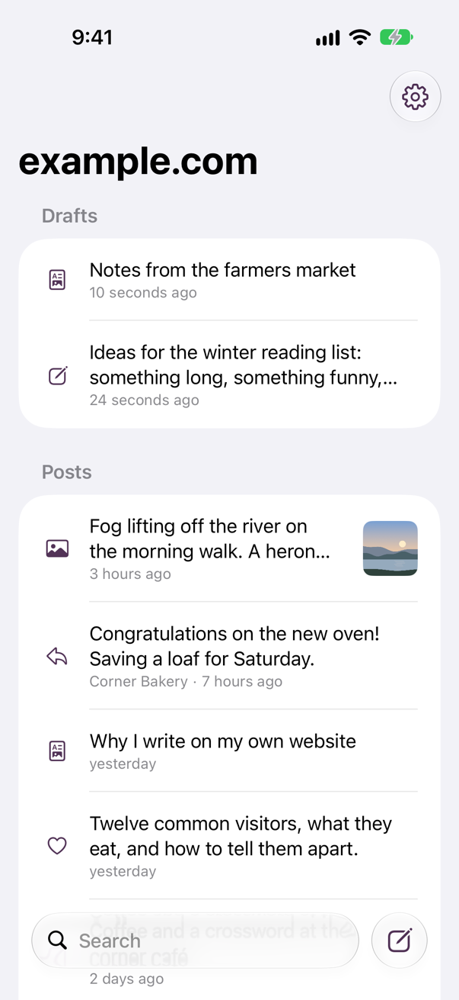
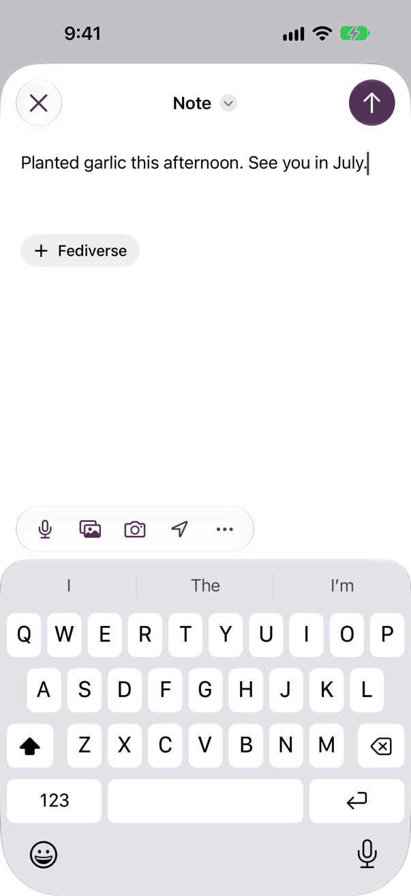
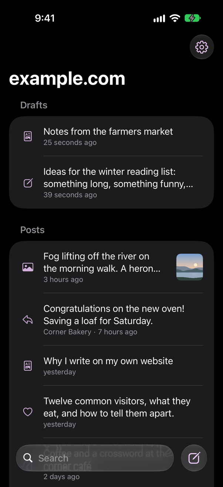
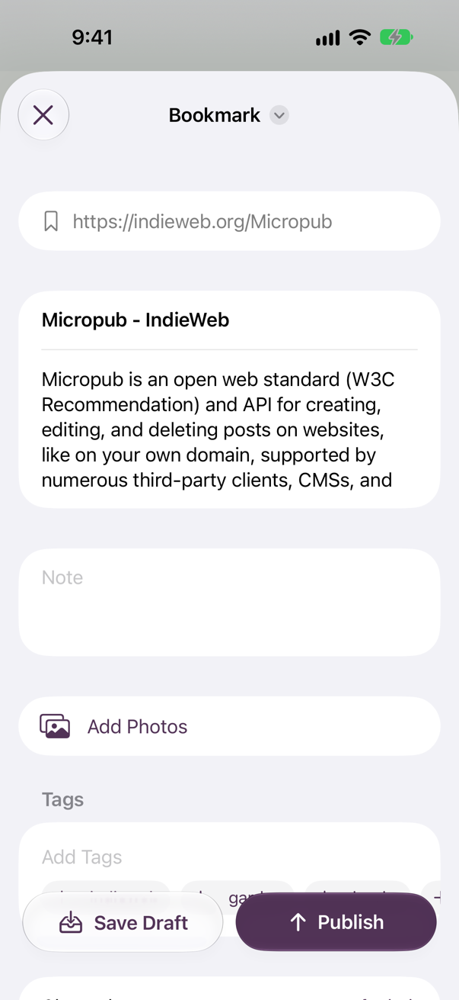

# Quill Native

A Micropub client for iPhone and iPad. Sign in with your own website and post to it. Based on the features of [Aaron Parecki’s Quill](https://github.com/aaronpk/Quill). iOS 17 or later; Liquid Glass on iOS 26 and 27.

## Screenshots

| | | | |
|---|---|---|---|
|  |  |  |  |

More on the [website](https://caseyg.github.io/quill-native/).

## Use

Enter your domain and tap **Sign In**. The app finds your site’s IndieAuth and Micropub endpoints and signs in through the system browser. A site that only issues tokens can use **Use an Access Token** instead.

- Tap the compose button for a note. Touch and hold it for another post type, or change the type from the title of an open post.
- Closing a post keeps it as a draft. Closing an empty one leaves nothing behind.
- The bar above the keyboard adds photos and location and opens Details: tags, slug, date, visibility, and the exact Micropub request.
- **Posts** lists everything on your site, downloaded with Micropub `q=source` and kept on the device for search. Sites without listing fall back to their feed, which usually holds only recent posts.
- Tap a post to edit it. Swipe for **See on Web**, **Edit** and **Delete**. Updates send only what changed. Events, reviews and other structured posts open on the web.
- **Settings → Post Types** hides types you don't use from the new-post menu and the list. **Markdown** writes posts as Markdown, sent as plain text with `p3k-content-type: text/markdown` (a Quill convention, since Micropub itself only defines text and HTML).

- **Settings → Drafts on GitHub** keeps a copy of every draft in a GitHub repository you choose. Each save writes the draft as a Markdown file with front matter, with its photos and recordings in `media/`; publishing or deleting a draft removes it. This is a backup, not publishing. In a public repository anyone can read the drafts, so the app asks first.

Post types: note, photo, reply and RSVP, article, bookmark, like, repost, event, review, itinerary, code, weight, exercise.

Also: a share extension that saves text, links and images as drafts; Shortcuts actions (**New Note**, **New Bookmark**, **Open Draft**); and links such as `quill-native://reply?reply=https%3A%2F%2Fexample.com%2Fpost`.

## Build

Open `QuillNative.xcodeproj`, choose the `QuillNative` scheme, and run. The only package is Apple’s [swift-markdown](https://github.com/swiftlang/swift-markdown), which the article editor uses to style Markdown as you type.

For a device, copy `Config/Signing.local.example.xcconfig` to `Config/Signing.local.xcconfig` and set your team ID. Use your own bundle IDs and App Group, and change `SharedStorage.group` and both entitlement files to match. Then:

```sh
./scripts/install_on_device.sh YOUR_DEVICE_ID
```

After adding source files, regenerate the project with `python3 scripts/generate_project.py`.

## IndieAuth client ID

IndieAuth identifies an app by a public URL that lists its redirect address. This app uses `https://caseyg.github.io/quill-native/`, which is [`docs/index.html`](docs/index.html) served by GitHub Pages (repository **Settings → Pages →** deploy from `main`, folder `/docs`).

A fork should host its own copy and set `QUILL_CLIENT_ID` in `Config/Signing.local.xcconfig`:

```
QUILL_CLIENT_ID = https:/$()/example.com/quill/
```

The page must contain `<link rel="redirect_uri" href="quill-native://oauth">`.

## GitHub sign-in

Drafts on GitHub signs in with GitHub’s [device flow](https://docs.github.com/apps/oauth-apps/building-oauth-apps/authorizing-oauth-apps#device-flow), which needs only a public client ID and no secret. Create an OAuth app (GitHub **Settings → Developer settings → OAuth Apps**), tick **Enable Device Flow**, and set its client ID:

```
QUILL_GITHUB_CLIENT_ID = Ov23li...
```

Without one, the app offers only a personal access token. A fine-grained token with read and write access to **Contents** on one repository is the narrowest choice.

## Test

```sh
swift test --package-path QuillCore
```

UI tests run on the `QuillNative` scheme against a local fixture, which they sign in to automatically. Start it first:

```sh
python3 scripts/fixture_server.py
```

It listens on `127.0.0.1:8765` only and accepts only the made-up `fixture-token`. The `--fixture`, `--route URL` and `--dark` launch arguments exist in debug builds only.

## Data

Tokens stay in the device Keychain. Drafts and their photos stay in the app’s App Group container. Nothing is sent anywhere except your own site, pages you ask it to preview, and, if you turn on Drafts on GitHub, the repository you choose. The GitHub token is in the Keychain too.

## Credits

Quill is by Aaron Parecki and contributors, Apache License 2.0. This is a new native implementation of compatible Micropub requests. See `NOTICE` and `LICENSE`. Design notes are in [docs/design.md](docs/design.md).
